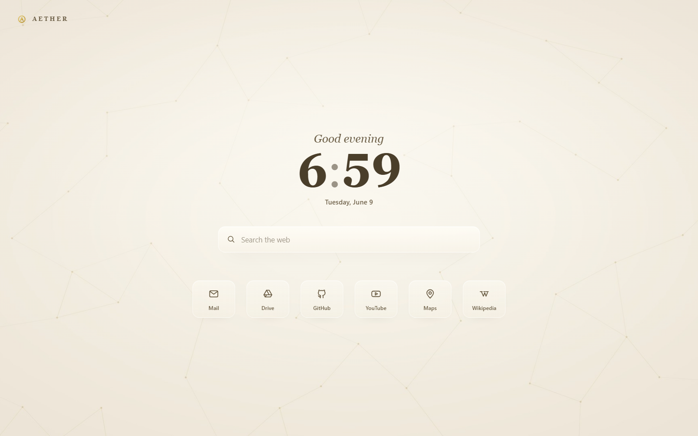
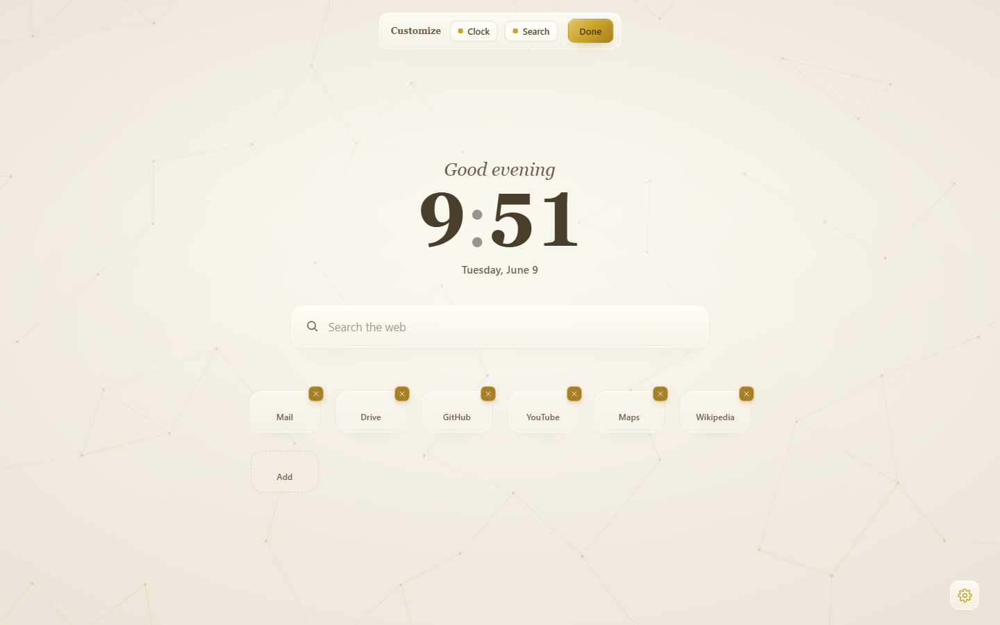
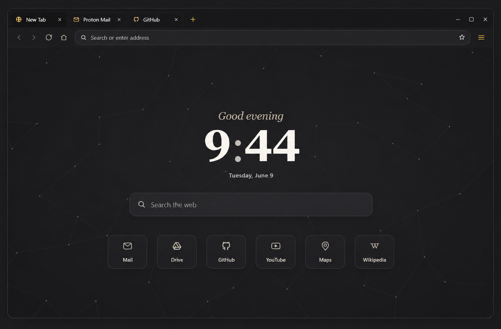

<h1 align="center">Flow</h1>

<b>The browser of <a href="https://github.com/aboutbeyrem/aether-os">Aether OS</a>.</b> 
Compiled from source on top of Brave (Chromium 149), rebranded down to the engine, with a calm warm-paper new tab.

Ships inside Aether OS · <a href="https://www.runaether.tn">runaether.tn</a>

---

## Why build a browser

Aether's whole point is a desktop that feels like one designed thing. A stock browser, with its own logo,
colours, onboarding and upsells, broke that the moment you opened it. So Flow takes Brave's engine and
privacy work and makes it look and behave like part of the OS.

## What's different

| | |
|---|---|
| **Rebranded at the source** | Not a theme on top of someone else's app. A build overlay rewrites names, the internal URL scheme (`aether://`), about/version pages, logos and colours inside the Brave source tree, then the whole browser is compiled. |
| **Its own new tab** | Clock and greeting set in a serif, one search field, shortcut tiles. Press **Ctrl+Shift+E** for **Customize mode**: drag the clock, search and shortcuts anywhere (with a snap-to-centre guide), hide or reset blocks, add / remove / reorder / edit sites, tint and blur the shortcuts block, and set an image, video or YouTube background. |
| **Command palette** | **Ctrl+Space** opens a palette to run any browser command by name (or type `:>` in the address bar). |
| **Real dark mode** | A proper browser theme switch, not just a dark page: the whole window uses Aether's dark palette, with the active tab picked out in gold. |
| **Shortcut icons that match** | Known sites get a gold line-art icon; anything else gets a gold monogram. No mismatched colourful favicons. |
| **Quiet by default** | Telemetry off. Rewards, crypto wallet, VPN, Tor and AI chat switched off by policy. Search goes through DuckDuckGo. |
| **One design system** | Same warm palette, gold accent and type as the rest of Aether. A hard rule: no pill-shaped buttons anywhere, only rounded rectangles. |

 

## Keyboard

| Keys | Does |
|---|---|
| `Ctrl` `Shift` `E` | Customize the new tab |
| `Ctrl` `Space` | Command palette |
| `:>` in the address bar | Command palette, inline |

## How it's built

- **Engine:** Brave 1.91 / Chromium 149, compiled from source in a Linux build environment (an overnight build; the
  result is a ~520 MB browser).
- **Rebrand overlay:** a set of idempotent transforms applied to a fresh Brave checkout. "Idempotent" matters: when
  Brave ships a new version, the same overlay re-applies cleanly instead of being redone by hand.
- **New tab swap:** Brave builds its new-tab page through one function. Flow changes that single chokepoint to serve
  its own page, instead of patching Brave's React new-tab code in many places. Fewer edits, fewer things to break
  on the next update.
- **Two delivery paths:** the full source build that ships in Aether OS, and a lighter runtime re-skin (policy +
  launcher + new tab on top of an unmodified Brave) used to prototype quickly. There's also a Windows setup script
  that puts Flow's new tab and shortcut on top of Brave, Chrome or Edge.

## Still to do

Being honest about what isn't finished: the on-disk binary still carries Brave's name, one window title still
leaks, and Flow doesn't have its own first-run welcome yet. Designed but not built yet: an optional shortcut bar
under the address bar (off by default, with a Settings toggle), and a menu entry for Customize next to the shortcut.

## Source code

Flow's source overlay is private. Flow is built on [Brave](https://github.com/brave/brave-core) and Chromium, both
open source; Brave's code is under the Mozilla Public License 2.0, and Flow's modified Brave files are available
on request.

## Built by

[Beyrem](https://github.com/aboutbeyrem), as part of Aether OS (2026). Built with AI pair-programming (Claude Code).
